# AI Disaster Rescue Robot Using A* and Multi-Agent Planning

**AI Case Study Project**  
**Presented by:** Haritha  
**Register Number:** 24BCE0412  
**Institution:** VIT Vellore, Department of Computer Science and Engineering  

---

## 📌 Executive Summary & Abstract
The **AI Disaster Rescue Robot** simulation is an autonomous multi-robot mission control platform designed to search, triage, and extract trapped civilians from hazardous, disaster-affected ruins (structural collapses, earthquakes, industrial explosions). The platform integrates:
1. **The $A^*$ Pathfinding Algorithm** with an admissible Manhattan distance heuristic to calculate mathematically optimal, low-cost routes through dynamic debris corridors in under 1 millisecond.
2. **Prioritized Multi-Agent Planning (Cooperative Space-Time $A^*$)** utilizing a 3D Space-Time Reservation Table $(x, y, t)$ to coordinate multiple autonomous robots simultaneously with zero vertex collisions or edge-swap deadlocks.
3. **Elite Visuals & Realistic Disaster Effects:**
   - **3D Fractured Concrete Rubble:** Depth bevels, multi-line fracture cracks, structural rebar, and ambient temperature readouts.
   - **Trapped Human Survivors:** Animated waving distress arms (SOS), high-vis emergency jackets with reflective bands, floating medical crosses, and biometric radar pulse rings.
   - **Autonomous Rescue Rover Robots:** Continuous caterpillar rubber tank treads with bogie wheels, armored chassis, revolving LiDAR camera turret with glowing cyan lens, strobe antenna, and forward-projecting search headlight illumination cones.
   - **Autonomous Aerial Reconnaissance Drone (UAV-RECON):** Autonomous quadcopter cruising overhead with spinning rotor blades, navigation strobes, and ground searchlight spotlight.
   - **Military FLIR Thermal Infrared Vision ('I' / 'T' key):** Simulates real SAR infrared thermal cameras, displaying ambient cold concrete ($14^\circ\text{C}$), glowing human body heat signatures ($37.2^\circ\text{C}$), and robot engine heat dispersion.
   - **Multimodal AI Survivor Triage Scanner ('C' key):** Interactive medical HUD displaying live patient EKG waveform, heart rate, blood oxygen (SpO2), core body temperature, entrapment load, and automated equipment recommendations.
   - **Live Tactical AI Radio Communications Feed:** Real-time tactical radio net banner logging microsecond dispatches between AI Command, UAV Recon, and Ground Rovers.
   - **Dynamic Particle Physics & Camera Shake:** Tank tread dust, secondary collapse rubble explosions, rescue sparkles, and camera screen-shake on aftershock tremors.
4. **Interactive Rescue Mission Dashboard:** Real-time victim counts, animated progress bars, live EKG oscilloscope vitals, algorithmic telemetry (pruning ratios, compute times, space-time yields), and a 3x3 interactive button grid.

---

## 🚨 Problem Statement
- **Hazardous Terrain:** Natural disasters leave humans trapped beneath collapsed concrete and unstable rubble where manual search and rescue poses mortal risk to human rescuers.
- **Search Delays:** Time is the most critical survival factor ("The Golden 72 Hours"). A single robot or manual team searching vast ruins is too slow.
- **Coordination Complexity:** Deploying multiple robots in constrained corridors frequently leads to **vertex collisions** (occupying the same cell simultaneously), **edge swap deadlocks** (attempting to pass each other in narrow corridors), and redundant target searching.
- **Proposed Solution:** Deploy autonomous agents using **$A^*$ pathfinding** for individual route optimization, combined with **centralized multi-agent space-time coordination**, **aerial drone reconnaissance**, and **AI multimodal triage** to guarantee collision-free, synchronized rescue operations.

---

## 🎯 Objectives
- **Optimal Pathfinding:** Determine the mathematically shortest, obstacle-free paths from starting positions to trapped victims.
- **Dynamic Rubble Avoidance:** Detect rubble blocks, collapsed pillars, and debris, routing safely around them.
- **Multi-Agent Synchronization:** Deploy two or three rescue robots operating concurrently within the same operational grid.
- **Collision Prevention:** Eliminate spatial and temporal conflicts using a 3D Space-Time Reservation Table ($x, y, t$).
- **Live Monitoring Dashboard:** Real-time visual tracking of victim rescue percentages, progress bar, conflict counts, and robot telemetry.

---

## 🏗️ 5-Layer System Architecture

```mermaid
flowchart TD
    subgraph Layer1 ["1. Input & Sensing Layer"]
        A["Grid Environment (18 x 13)"]
        B["Rubble & Debris Map (up to 71 blocks)"]
        C["Robot Starting Coordinates"]
        D["Trapped Victim Locations & Biometrics"]
        E["Aerial UAV Reconnaissance Feed"]
    end

    subgraph Layer2 ["2. AI Planning & Coordination Layer"]
        F["Target Allocation & Decomposition"]
        G["Lead Robot: Standard A* Search"]
        H["Space-Time Reservation Table (x, y, t)"]
        I["Follower Robot: Space-Time Cooperative A*"]
    end

    subgraph Layer3 ["3. Execution & Safety Layer"]
        J["Synchronized Step Movement with LERP"]
        K["Runtime Conflict Check (Vertex & Swap)"]
        L["Dynamic Yield / Wait Inserter"]
        M["Online Replanning on Debris Surges"]
    end

    subgraph Layer4 ["4. Visualization & Sensor Layer (Pygame)"]
        N["3D Fractured Concrete & Exposed Rebar"]
        O["Animated Human Survivors (SOS Waving)"]
        P["Search Rovers with Tracked Treads & Headlights"]
        Q["Aerial UAV Quadcopter with Spotlight"]
        R["FLIR Thermal Infrared Camera Mode"]
    end

    subgraph Layer5 ["5. Mission Monitoring & Triage Dashboard"]
        S["Victim Progress & EKG Heartbeat Monitor"]
        T["AI Multimodal Survivor Triage Scanner"]
        U["Live Tactical AI Radio Dispatch Net"]
        V["Algorithmic Telemetry & 3x3 Control Grid"]
    end

    Layer1 --> Layer2
    Layer2 --> Layer3
    Layer3 --> Layer4
    Layer4 --> Layer5
```



---

## 🧠 AI Algorithms & Theoretical Formulations

### 1. The $A^*$ Pathfinding Algorithm
The $A^*$ algorithm evaluates nodes by combining the exact path cost $g(n)$ from the start node and an estimated heuristic cost $h(n)$ to the target:
$$f(n) = g(n) + h(n)$$

- **$g(n)$ (Exact Path Cost):** The cost accumulated from the start node to the current cell $n$. On our orthogonal grid, each step has a uniform cost $c(u, v) = 1$.
- **$h(n)$ (Manhattan Distance Heuristic):**
  $$h(n) = |x_n - x_{\text{goal}}| + |y_n - y_{\text{goal}}|$$

#### Proof of Optimality (Admissibility & Consistency):
- **Admissibility:** Since robots move in 4 cardinal directions (orthogonal), the Manhattan distance is the theoretical minimum number of steps required to reach the goal with zero obstacles:
  $$h(n) \le h^*(n) \quad \forall n$$
- **Consistency (Triangle Inequality):** For any neighboring nodes $n$ and $n'$:
  $$h(n) \le c(n, n') + h(n')$$
  Since $h(n)$ is consistent and admissible, the first time $A^*$ expands the goal node, the path is guaranteed to be **globally optimal**.
- **Time Complexity:** $O(b^d)$ where $b$ is the branching factor ($\le 4$) and $d$ is the solution depth. In practice, the Manhattan heuristic achieves **85%+ search space pruning** compared to uninformed algorithms like Dijkstra or BFS.

---

### 2. Multi-Agent Planning & Conflict Resolution
When multiple robots navigate the same disaster site, naive independent pathfinding causes collisions. Our system implements a **2-Tier Coordination Architecture**:

#### Tier 1: Prioritized Planning via Space-Time Reservation ($x, y, t$)
1. **Target Allocation:** Computes minimal total Manhattan cost:
   $$\arg\min_{\pi} \sum_{i} \text{dist}(R_i, V_{\pi(i)})$$
2. **Lead Agent Planning ($R_1$):** Robot 1 plans its optimal route using standard $A^*$.
3. **Reservation Table Registration:**
   - **Vertex Reservations:** For every step $t$, $(x, y, t)$ is locked.
   - **Swap Reservations:** For transitions from $(u_x, u_y)$ to $(v_x, v_y)$ at time $t$, the reverse transition is blocked for all other agents at $t$.
4. **Cooperative Space-Time $A^*$ ($R_2, R_3$):** Follower robots plan trajectories in 3D configuration space $(x, y, t)$. Available actions at each tick are:
   $$\text{Actions} = \{\text{Right}, \text{Up}, \text{Down}, \text{Left}, \text{Wait}(0, 0)\}$$
   If an intersection is detected, the follower automatically inserts a single **Wait** action at an adjacent safe cell or routes through an alternate corridor.

#### Tier 2: Real-Time Dynamic Safety Monitor
During runtime ticks, if unexpected dynamic rubble or timing anomalies occur, the safety monitor checks:
- **Vertex Conflict:** $\text{next}_1 == \text{next}_2$
- **Swap Conflict:** $\text{next}_1 == \text{pos}_2 \land \text{next}_2 == \text{pos}_1$
If true, lower-priority robots yield for 1 step while higher-priority robots clear the junction.

---

## 💻 Tech Stack & Requirements
- **Language:** Python 3.10+ (Tested on Python 3.12.5)
- **GUI Engine:** Pygame 2.6.1
- **Data Structures:** Min-Heap (`heapq`), Hash Sets (`set`), Coordinate Tuples
- **Math & Sound:** NumPy (built-in procedural sound synthesis: step clicks, rescue chimes, victory fanfare, radio chirps)

---

## 🚀 How to Run the Project

### Option A: One-Click Launch (Windows)
Double-click the bundled batch file:
```cmd
run_demo.bat
```

### Option B: Terminal Command
```bash
# Navigate to project folder
cd "D:\AI project"

# Run main simulation
python main.py
```

---

## 🎮 Interactive Controls & Shortcuts

| Key / Control | Action | Purpose in Evaluation / Demo |
| :--- | :--- | :--- |
| **`A` / Button** | **Cycle Search Algorithm** | **Live AI Benchmark:** Cycles between **$A^*$**, **Dijkstra**, **Greedy Best-First**, and **BFS**. Demonstrates live node expansion differences! |
| **`M`** | **Cycle Heuristic Metric** | Toggles between **Manhattan** ($L_1$), **Euclidean** ($L_2$), and **Chebyshev** ($L_\infty$). |
| **`D` / Button** | **+ Debris Surge** | **Earthquake Tremor:** Drops 5 dynamic rubble blocks with camera screen-shake, dust particles, and live online replanning! |
| **`C` / Button** | **AI Survivor Triage Modal** | Opens the **AI Multimodal Survivor Triage Scanner** with live patient biometrics (Heart Rate, SpO2, Temp, EKG, entrapment load). |
| **`I` / Button** | **FLIR Thermal Vision** | Toggles **Military FLIR Thermal Infrared Vision** mode showing cold rubble vs. glowing $37.2^\circ\text{C}$ body-heat signatures. |
| **`T` / Button** | **Cycle Theme** | Cycles between **Classic Presentation White**, **Tactical Dark Command Center**, and **FLIR Thermal**. |
| **`F` / Button** | **Toggle Fog of War** | **LiDAR Recon Mode:** Unexplored grid shrouded in darkness; robot headlights and drone spotlight reveal territory. |
| **`H`** | **Toggle Heatmap** | Shows $A^*$ closed set (explored nodes) in translucent colors to prove 85%+ pruning. |
| **`F1`** | **Help & Architecture Guide** | Translucent overlay displaying all keybindings, equations, and architecture details. |
| **`R` / Button** | **Restart Mission** | Resets robots and re-executes search from start. |
| **`SPACE` / Button** | **Pause / Resume** | Freeze simulation to explain current state to evaluator. |
| **`S`** | **Single Step** | Advance by exactly 1 grid tick to demonstrate step-by-step decision making. |
| **`1` – `5` / Button** | **Switch Scenarios** | Switch between 5 levels of disaster difficulty (up to 71 rubble blockages). |
| **`N`** | **Random Disaster Map** | Generates procedural high-density rubble field with verified path solvability. |
| **`P`** | **Save Screenshot** | Captures high-res screenshot directly to `disaster_rescue_simulation.png`. |
| **Left Click** | **Inspect / Toggle Rubble** | Click a trapped victim to open their AI Triage card, or click empty cells to toggle rubble dynamically! |

---

## 🗺️ Pre-Configured High-Difficulty Scenarios

1. **Scenario 1 — Heavy Debris Collapse (37 Rubble Blocks):**
   - Reinforced presentation scenario with cross-beams and structural rubble.
   - Demonstrates optimal corridor routing over and under rubble obstacles.

2. **Scenario 2 — High-Conflict Chokepoints (56 Rubble Blocks):**
   - Constricted passages forcing Space-Time $A^*$ conflict resolution.
   - Robot 2 automatically yields 1 wait step for Robot 1 to clear the corridor safely.

3. **Scenario 3 — Tri-Agent Dense Ruins (63 Rubble Blocks):**
   - 3-Agent Swarm matching system architecture diagram: **Agent 1: Scout**, **Agent 2: Lifter**, and **Agent 3: Medic**.
   - Navigates heavy structural debris to rescue 3 separate trapped victims.

4. **Scenario 4 — Tremor Surge & Rubble Collapse (Dynamic Hard):**
   - Real-time aftershocks drop secondary rubble during execution; robots dynamically reroute in real time.

5. **Scenario 5 — Catastrophic Labyrinth (71 Rubble Blocks - MAXIMUM Difficulty):**
   - Extreme structural failure: 71 rubble blocks forming a serpentine maze of narrow 1-cell voids.
   - Tests deep $A^*$ heuristic navigation through complex dead ends and tight corridors.

---

## 🎓 Faculty Viva Voce Q&A Cheat Sheet

### Q1: Why did you choose $A^*$ instead of Dijkstra's Algorithm?
> **Answer:** Dijkstra's algorithm explores nodes uniformly in all directions (concentric circles) regardless of where the victim is located, leading to excessive node expansions. $A^*$ uses a heuristic $h(n)$ (Manhattan distance) to guide the search directionally towards the victim. This drastically reduces the number of explored states while mathematically guaranteeing the optimal shortest path.

### Q2: Why is Manhattan distance chosen over Euclidean distance on this grid?
> **Answer:** In our simulation, robots move in 4 cardinal orthogonal directions (Right, Left, Up, Down). On an orthogonal grid without diagonal traversal, Euclidean distance ($\sqrt{\Delta x^2 + \Delta y^2}$) underestimates the actual step distance too severely. Manhattan distance ($|\Delta x| + |\Delta y|$) represents the exact shortest distance in an obstacle-free grid, making it an admissible and consistent heuristic that expands fewer redundant nodes.

### Q3: What is the condition for $A^*$ to be optimal?
> **Answer:** $A^*$ is guaranteed to find the optimal path if the heuristic function $h(n)$ is **admissible** (it never overestimates the true cost to reach the goal: $h(n) \le h^*(n)$). When used with graph search (preventing re-visiting nodes in the closed set), the heuristic must also be **consistent** (monotonic), satisfying $h(n) \le c(n, n') + h(n')$.

### Q4: How does multi-agent coordination prevent collisions between the robots?
> **Answer:** We employ **Prioritized Planning with Space-Time Reservation Tables**:
> 1. Higher-priority Agent 1 plans its route using standard $A^*$.
> 2. Agent 1's trajectory is registered in a reservation table $(x, y, t)$.
> 3. Agent 2 uses **Space-Time $A^*$**, treating Agent 1's scheduled positions as dynamic obstacles in 3D $(x, y, t)$ space.
> 4. Agent 2 can perform a `WAIT` action (cost = 1) or take an alternative detour when an intersection is detected.
> 5. A secondary runtime check validates every step before physical execution to prevent vertex and edge-swap conflicts.

### Q5: What is the difference between a Vertex Conflict and an Edge Swap Conflict?
> **Answer:**
> - **Vertex Conflict:** Two robots attempt to occupy the exact same coordinate $(x, y)$ at the same time step $t$ ($pos_1(t) == pos_2(t)$).
> - **Edge Swap Conflict:** Two robots swap positions across an edge in opposite directions at the same time step ($pos_1(t) == pos_2(t+1) \land pos_1(t+1) == pos_2(t)$).
> Our Space-Time $A^*$ explicitly prevents both types by reserving vertex cells and directional transition edges.

### Q6: What happens if a rescuer clicks to place rubble directly on a planned path?
> **Answer:** The simulation features **Real-Time Dynamic Replanning**. When the grid state changes, `replan_from_current_positions()` triggers instantly from each robot's current coordinates, calculating new collision-free paths around the newly created obstacle in under 2 milliseconds.

---

## 📊 File Structure & Module Overview

```
D:\AI project\
│
├── main.py              # Primary application entrypoint and Pygame rendering loop
├── simulation.py        # Core state machine, agent classes, victim tracking, step tick, UAV drone
├── astar.py             # A* and Space-Time A* search algorithms with heuristics
├── multi_agent.py       # Space-Time reservation table & conflict resolution engine
├── config.py            # Dimensions, color palettes (Classic, Tactical, Thermal), and 5 scenarios
├── particles.py         # Particle manager (dust, rubble explosion debris, sparkles, camera shake)
├── sound_effects.py     # NumPy procedural sound synthesis (chimes, clicks, fanfare, radio chirps)
├── run_demo.bat         # Windows one-click launcher
├── PRESENTATION_SCRIPT.md # 5-minute timed demo script and slide-by-slide talking points
├── PROJECT_REPORT.md    # Complete academic case study report with mathematical proofs
└── README.md            # Comprehensive documentation, theory, and viva preparation guide
```
